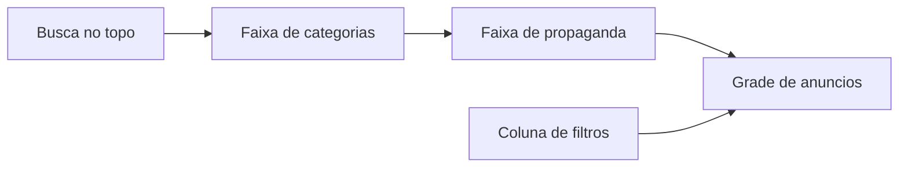

# Vitrine no estilo Marketplace e Enjoei

A home hoje é uma página editorial: hero grande, vários trilhos e cards com legenda de vidro cobrindo a foto. O Facebook Marketplace e o Enjoei abrem direto na mercadoria. A mudança fica nesse miolo (home, grade, card, categorias, propaganda e filtros). Login, ficha do produto, mensagens, admin e o app Flutter ficam como estão.

## Pacote

Continua o **Tailwind CSS 4** que já está em [frontend/package.json](frontend/package.json). Não entra shadcn, MUI nem outro kit: eles puxam o visual genérico que o projeto evita, e os tokens já existem em [frontend/src/app/globals.css](frontend/src/app/globals.css) e [frontend/src/lib/ui-classes.ts](frontend/src/lib/ui-classes.ts).

A paleta creme e terracota atual é exatamente a que o `AGENTS.md` pede para não usar. A vitrine passa a um canvas cinza frio (perto do fundo do Marketplace), superfície branca, texto carvão e borda fina. Botão de vender e estado ativo ficam em tinta preta com texto branco. Sem rosa do Enjoei e sem azul do Facebook: a combinação é de **estrutura**, não de cor de marca alheia.

## Direção

Nome: **balcão aberto**. A foto do anúncio fica limpa. O preço é uma pílula branca no canto da imagem, como no print do Marketplace. Embaixo: título e "há 32 min · cidade". As categorias viram uma faixa de círculos rolável, no jeito do Enjoei. Os filtros viram a coluna da esquerda, na ordem do print: preço, lugar, categorias.

Na home a coluna de filtros não aparece (descoberta, como o Enjoei). Ela entra em `/geral`, `/buscar`, `/categoria`, `/novidades`, `/promocoes`, `/ofertas` e `/marcas`, que já passam por [frontend/src/components/CatalogPage.tsx](frontend/src/components/CatalogPage.tsx).

## O que muda

**Tokens.** Em [frontend/src/app/globals.css](frontend/src/app/globals.css), trocar canvas, superfície, borda e tinta para cinza neutro. `--color-brand-500` deixa de ser terracota e passa a ser o carvão, para os botões que já usam `bg-brand-500 text-white` continuarem legíveis. Manter `text-white` nesses botões.

**Cabeçalho.** Em [frontend/src/components/Header.tsx](frontend/src/components/Header.tsx), a busca continua dominante. Sai a fileira de categorias em texto (elas vão para a faixa e para o filtro). Entra um botão "Vender" visível, no papel do "+ Sell Something".

**Home.** Reescrever [frontend/src/app/page.tsx](frontend/src/app/page.tsx):

- Faixa horizontal com as categorias de [frontend/src/lib/catalog.ts](frontend/src/lib/catalog.ts) e [frontend/src/components/CategoryIcon.tsx](frontend/src/components/CategoryIcon.tsx), círculo, nome curto, link para `/geral?category=`.
- Propaganda logo abaixo, mais baixa (cerca de 140px), ainda com clique, impressão e `resolveImageUrl` de [frontend/src/components/PromotionCarousel.tsx](frontend/src/components/PromotionCarousel.tsx).
- Uma grade densa de novidades (o anúncio é o conteúdo). Some o hero e os seis `HomeRail` empilhados. A faixa de afiliados fica uma vez, depois da grade, se houver itens.

**Card.** [frontend/src/components/ProductCard.tsx](frontend/src/components/ProductCard.tsx) e [frontend/src/components/ProductTile.tsx](frontend/src/components/ProductTile.tsx) passam ao mesmo desenho: foto quadrada, pílula de preço, coração no canto, título em até duas linhas, tempo relativo a partir de `created_at` e cidade (`city.name` ou `location`). O helper de tempo fica em `frontend/src/lib`, sem `'use client'`. Visualizações saem da face do card. Favoritar continua igual.

**Filtros.** Reordenar o conteúdo de [frontend/src/components/ListingFilters.tsx](frontend/src/components/ListingFilters.tsx) para: preço (mín. e máx. lado a lado, como no print), localização (estado e cidade), categorias em lista com ícone, condição e tipo mais abaixo. Os parâmetros de URL não mudam. Não inventar raio em km: a API não tem esse filtro. A gaveta mobile que já existe permanece. A coluna em `CatalogPage` fica grudada no scroll (`sticky`), sem barra interna.

**Grade.** Em [frontend/src/lib/ui-classes.ts](frontend/src/lib/ui-classes.ts), a grade de navegação fica mais densa (2 colunas no celular, 4 ou 5 no desktop) e o vão entre cards menor, para a página parecer prateleira e não revista.

## Fora deste passo

Ficha do produto, formulário de anúncio, mensagens, login e o app Flutter. Sem commit.

## Verificação

Abrir a home, `/geral`, `/promocoes` e uma busca. Aplicar preço, categoria e cidade, e conferir se a grade reage. No celular, rolar categorias, abrir o filtro e favoritar um card. Rodar `cd frontend && npx tsc --noEmit`. Conferir `text-white` nos botões escuros e ausência de `color` global em `a`.
